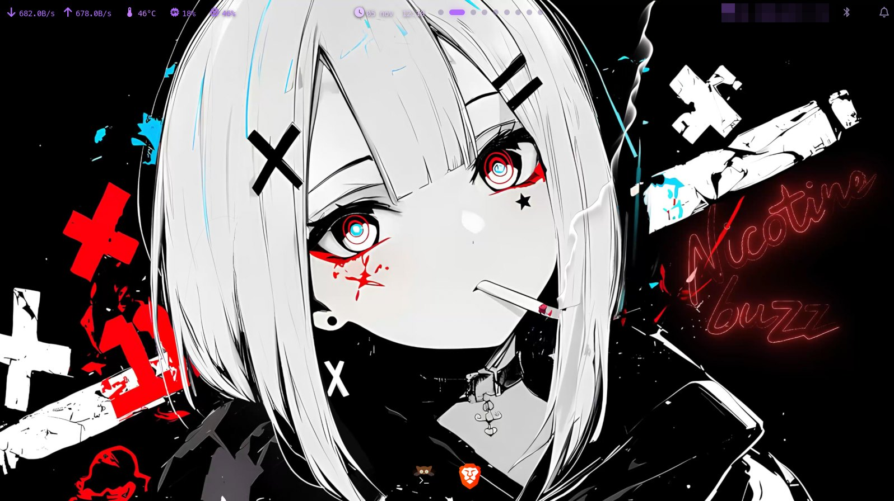
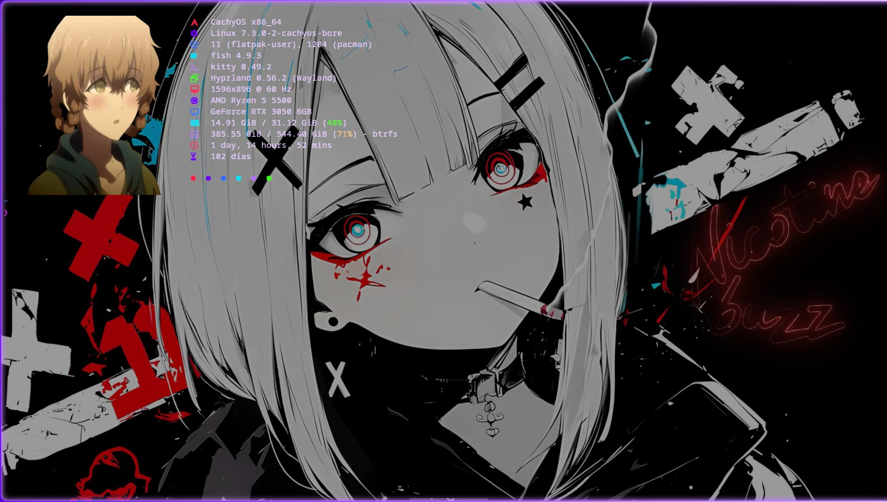
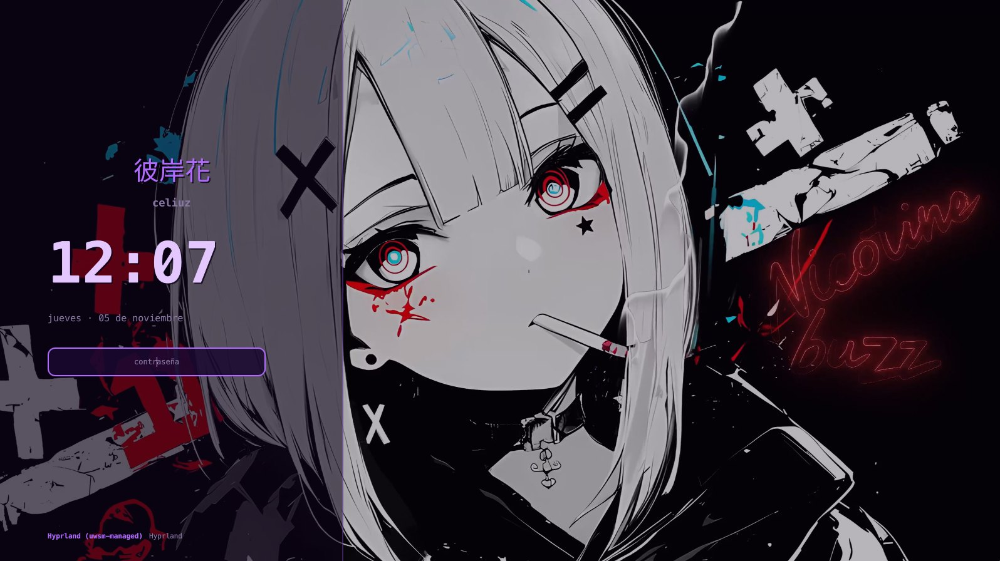
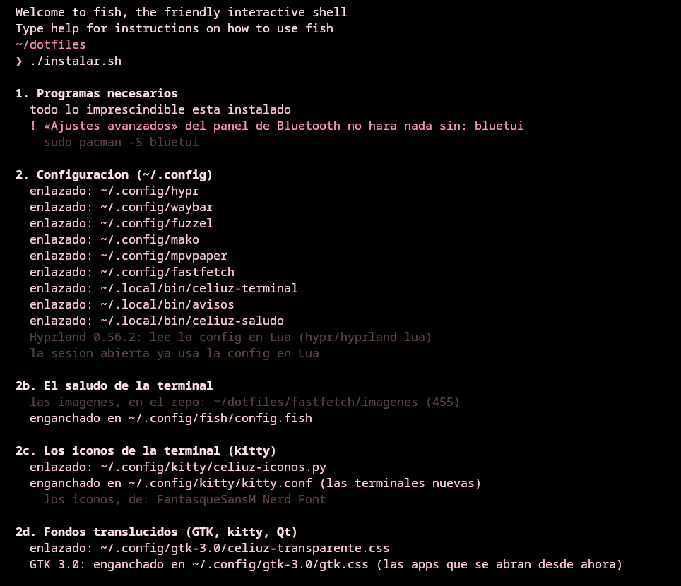
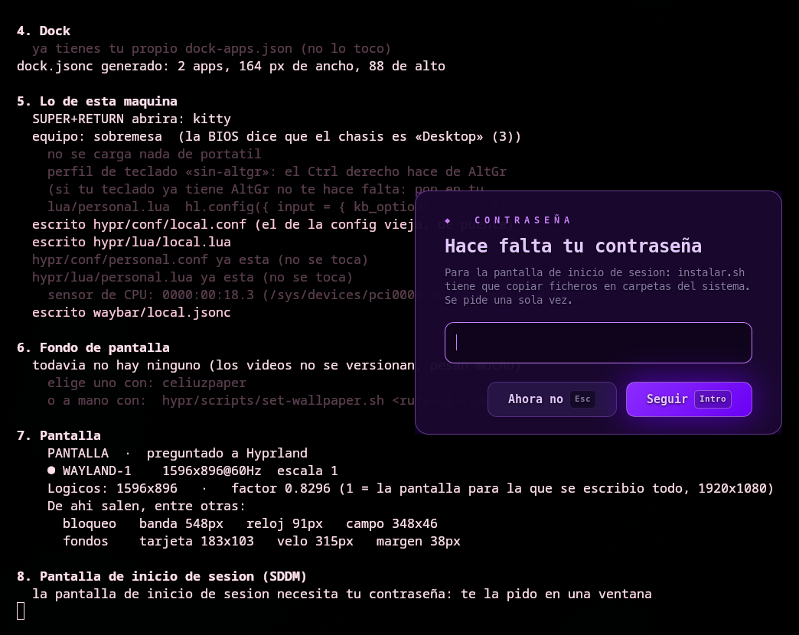
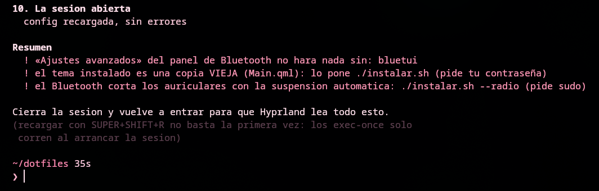

# Instalar el escritorio, paso a paso

Esta guía es para dejar el escritorio de este repo funcionando en un equipo con
**CachyOS** (o Arch) y **Hyprland**, aunque nunca hayas tocado unos dotfiles.
Cada orden lleva al lado qué hace y qué toca, para que sepas en todo momento
qué estás instalando.

Son cinco pasos y se tarda unos diez minutos, casi todo en descargar paquetes:

1. [Instalar los programas](#1-instalar-los-programas)
2. [Descargar el repo](#2-descargar-el-repo)
3. [Ejecutar el instalador](#3-ejecutar-el-instalador) (aquí se pide la contraseña **una vez**)
4. [Cerrar sesión y volver a entrar](#4-cerrar-sesión-y-volver-a-entrar)
5. [Elegir un fondo de pantalla](#5-elegir-un-fondo-de-pantalla)

¿Vas a instalarlo pidiéndoselo a **Claude Code**? Lee también
[Con Claude Code](#con-claude-code).

---

## Lo que vas a tener

El escritorio recién instalado: la barra arriba, el dock abajo (con tu terminal
y tu navegador, nada más; el resto lo añades tú) y el fondo en vídeo.



Cada terminal que abras te saluda con una imagen y los datos del equipo:



Y al encender el equipo, la pantalla de inicio de sesión (SDDM) con el mismo
estilo y tu fondo:



---

## Antes de empezar

- **CachyOS o Arch** con **Hyprland 0.56 o más nuevo**. Lo miras con
  `Hyprland --version`; si es más viejo, `sudo pacman -Syu` primero.
- **SDDM** como pantalla de inicio de sesión, si quieres la de este repo. Lo
  miras con `systemctl is-enabled sddm`: si dice `enabled`, la tienes. Si usas otra (GDM, ly, greetd), todo lo demás funciona igual y el
  instalador se salta ese paso solo.
- **Acceso al repo.** Es privado: el dueño tiene que añadirte como colaborador
  en GitHub antes de que puedas descargarlo.

Nada de esto pisa tu configuración sin guardarla: si ya tenías algo en
`~/.config/hypr` (o en waybar, mako...), el instalador lo **aparta** con la
fecha en el nombre (`hypr.antes-de-dotfiles-20261105-120000`) y te avisa.

---

## 1. Instalar los programas

El instalador **no instala paquetes por su cuenta**: te dice cuáles faltan.
Para no ir descubriéndolos de uno en uno, instálalos antes. Todos están en los
repos oficiales de CachyOS/Arch; no hace falta nada del AUR.

**Los imprescindibles** (sin ellos el escritorio no arranca o se queda a medias):

```sh
sudo pacman -S --needed hyprland waybar fuzzel kitty hyprlock hypridle mpvpaper mako \
               grim slurp wl-clipboard uwsm libnotify \
               python-gobject gtk-layer-shell ffmpeg librsvg \
               ttf-meslo-nerd noto-fonts-cjk \
               wireplumber playerctl \
               ananicy-cpp cachyos-ananicy-rules
```

| Paquetes | Para qué |
|---|---|
| `hyprland`, `uwsm` | el escritorio, y quien arranca cada app en su sitio |
| `waybar`, `fuzzel`, `mako` | la barra y el dock, el lanzador de apps, las notificaciones |
| `kitty` | la terminal |
| `hyprlock`, `hypridle` | la pantalla de bloqueo, y bloquear solo al dejar el equipo quieto |
| `mpvpaper`, `ffmpeg` | el fondo en vídeo, y sacarle fotogramas |
| `grim`, `slurp`, `wl-clipboard` | las capturas de pantalla y el portapapeles |
| `python-gobject`, `gtk-layer-shell`, `librsvg`, `libnotify` | las ventanas propias del repo (paneles, menús, tarjetas) |
| `ttf-meslo-nerd`, `noto-fonts-cjk` | los iconos de la barra y los kanji del bloqueo |
| `wireplumber`, `playerctl` | las teclas de volumen y de música |
| `ananicy-cpp`, `cachyos-ananicy-rules` | saber qué es un juego, para no congelarlo al bloquear |

**Los recomendados** (el escritorio arranca sin ellos, pero algo concreto no
funcionará y el instalador te lo dirá):

```sh
sudo pacman -S --needed sddm qt6-multimedia qt6-multimedia-ffmpeg \
               fastfetch kvantum wf-recorder qrencode \
               mission-center nvtop btop
```

| Paquetes | Para qué |
|---|---|
| `sddm`, `qt6-multimedia`, `qt6-multimedia-ffmpeg` | la pantalla de inicio de sesión, con el fondo en vídeo |
| `fastfetch` | el saludo de la terminal |
| `kvantum` | que Dolphin y las apps Qt dejen ver el fondo, como las demás |
| `wf-recorder` | grabar la pantalla (`SUPER + R`) |
| `qrencode` | el QR para compartir el wifi desde su panel |
| `mission-center`, `nvtop`, `btop` | los monitores del sistema que abre la barra |

**Solo si te hacen falta:**

```sh
sudo pacman -S --needed brightnessctl                  # portátil: las teclas de brillo
sudo pacman -S --needed bluez bluez-utils bluetui      # si el equipo tiene Bluetooth
sudo systemctl enable --now bluetooth                  #   (y encenderlo)
sudo pacman -S --needed mangohud lib32-mangohud mpv    # el modo gaming (SUPER + G)
```

---

## 2. Descargar el repo

Como el repo es privado, primero tienes que entrar con tu cuenta de GitHub. Lo
más fácil es con la herramienta oficial, `gh`:

```sh
sudo pacman -S --needed git github-cli
gh auth login                                        # te guía: elige GitHub.com y el navegador
gh repo clone Pceliuz/Celiuz_CachyOS ~/dotfiles      # lo descarga en ~/dotfiles
cd ~/dotfiles
```

(Si ya tienes una llave SSH en GitHub, vale igual
`git clone git@github.com:Pceliuz/Celiuz_CachyOS.git ~/dotfiles`.)

**Puedes ponerlo donde quieras**: `~/dotfiles`, `~/.dotfiles`, `~/repos/lo-que-sea`.
Lo único que no hay que hacer es **moverlo después** de instalar sin volver a
pasar `./instalar.sh`, porque la configuración apunta a esa carpeta.

---

## 3. Ejecutar el instalador

Desde la carpeta del repo:

```sh
./instalar.sh
```

Si antes quieres ver **qué haría sin que toque nada**, usa
`./instalar.sh --revisar`. Enseña cada orden que ejecutaría, y no pide
contraseña.

Va por pasos numerados y en cada uno dice lo que ha hecho:



### Qué hace cada paso

Todo lo de los pasos 1 a 7 y 9 se queda **dentro de tu carpeta personal**
(`~/.config`, `~/.local`) y dentro del propio repo. Ninguno de ellos pide
contraseña.

| Paso | Qué hace |
|---|---|
| **1. Programas necesarios** | Mira qué falta y te da la orden de `pacman` para instalarlo. No instala nada. |
| **2. Configuración** | Enlaza las carpetas del repo en `~/.config`: `hypr`, `waybar`, `fuzzel`, `mako`, `mpvpaper`, `fastfetch`. Son **enlaces**, no copias: editar el repo es editar tu configuración. Lo que hubiera antes lo aparta con la fecha. |
| **2b–2d** | El saludo de la terminal (una línea al final de `~/.config/fish/config.fish`), los iconos de kitty y que las apps dejen ver el fondo (una línea en `gtk.css` y en `kitty.conf`, y el tema `Celiuz` de Kvantum). Si ya tenías algo tuyo en esos ficheros, lo respeta. |
| **3. CeliuzPaper** | El selector de fondos de pantalla: su orden, su icono y su entrada en el lanzador. |
| **4. Dock** | Crea el dock de **este** equipo con tu terminal y tu navegador predeterminado. Las demás apps las añades tú con clic derecho sobre un icono del dock. |
| **5. Lo de esta máquina** | Averigua si es portátil o sobremesa, la terminal, el teclado y el sensor de temperatura, y lo escribe en ficheros que **no** se suben a git (`hypr/lua/local.lua`, `waybar/local.jsonc`). También te crea `hypr/lua/personal.lua`, vacío, para tus propios ajustes. |
| **6. Fondo de pantalla** | Te dice si ya hay uno elegido. Los vídeos no vienen en el repo (pesan mucho). |
| **7. Pantalla** | Pregunta a Hyprland la resolución de cada pantalla y calcula los tamaños del bloqueo y de los fondos. No escribe nada. |
| **8. Pantalla de inicio de sesión** | **El único paso que pide contraseña.** Ver abajo. |
| **9. Celiuz Remoto** | Deja puesta la app para manejar el equipo desde el celular, pero **apagada**. Se enciende a mano desde su ventana (guía aparte: [`remoto/INSTALAR.md`](remoto/INSTALAR.md)). |
| **9b. Wifi y Bluetooth** | Mira si tu tarjeta de wifi o tu Bluetooth se cortan por ahorro de energía. Si es así, te sugiere `./instalar.sh --radio` (ver [Extras](#extras-opcionales)). |
| **10. La sesión abierta** | Recarga Hyprland para que vea lo nuevo, y comprueba que la configuración no tiene errores. |

### El paso 8: la pantalla de inicio de sesión (SDDM)

La pantalla de inicio tiene que vivir en carpetas del sistema, que son de root,
así que este paso **necesita tu contraseña** (la misma de `sudo`). Se pide **una
sola vez**, y solo si hace falta: si la pantalla ya está puesta y al día, el
instalador no pregunta nada.

Si lo ejecutas en una terminal, pregunta ahí. **Intro** dice que sí y luego
escribes tu contraseña; **`n`** se lo salta:

![El paso 8 pregunta «¿Lo hago ahora? [S/n]» antes de pedir la contraseña](docs/instalar/2-instalar-pide-contrasena.png)

Si lo ejecuta algo que no es una terminal (Claude Code, por ejemplo), la
contraseña se pide en esta ventana, encima de todo:



**Seguir** (o Intro) instala la pantalla de inicio. **Ahora no** (o Esc) se la
salta, y el resto de la instalación sigue igual. La contraseña va de la casilla
directamente a `sudo` y no se guarda en ningún sitio.

Esto es **todo** lo que el paso 8 pone fuera de tu carpeta personal:

| Dónde | Qué es |
|---|---|
| `/usr/share/sddm/themes/celiuz/` | el tema: una copia de `sddm/celiuz/` del repo |
| `/etc/sddm.conf.d/10-celiuz.conf` | un fichero de 4 líneas que le dice a SDDM que use ese tema |
| `/var/lib/sddm-celiuz/` | el fondo del inicio. Es **tuyo**, así que se rehace solo cada vez que cambias de fondo, sin volver a pedir contraseña |
| `/etc/systemd/logind.conf.d/celiuz-sin-sak.conf` | que `Ctrl+Alt+Shift+Esc` no saque la pantalla de inicio encima del bloqueo |

Para quitarlo todo y volver a la pantalla de antes: `./instalar.sh --sddm-quitar`.

### El final: el resumen

Al terminar sale un **Resumen** con lo que quedó pendiente, si hay algo. Cada
`!` lleva al lado lo que hay que hacer:



Lo ideal es que diga **«sin pendientes»**. Si falta un paquete, instálalo y
**vuelve a pasar `./instalar.sh`**: se puede repetir cuantas veces quieras y no
rehace lo que ya está bien.

---

## 4. Cerrar sesión y volver a entrar

Lo que arranca con el escritorio (la barra, el fondo, los avisos) solo se pone
en marcha al **entrar**, así que la primera vez no basta con recargar: cierra
la sesión (`SUPER + SHIFT + P` → «Cerrar sesión») y vuelve a entrar. Ahí verás
ya la pantalla de inicio nueva.

## 5. Elegir un fondo de pantalla

Los vídeos de fondo no vienen en el repo. Abre **CeliuzPaper** (está en el
lanzador, `SUPER + B`, o escribe `celiuzpaper` en una terminal) y elige
uno de tu carpeta de Vídeos. El fondo de la pantalla de inicio se actualiza
solo con él.

Listo. Los atajos de teclado están en el [README](README.md#atajos).

---

## Con Claude Code

Si instalas pidiéndoselo a Claude Code, basta con algo así:

> Descarga mi repo Pceliuz/Celiuz_CachyOS en ~/dotfiles e instálalo siguiendo
> INSTALAR.md.

Lo que pasa por dentro es lo mismo que en esta guía, con dos momentos en los
que te toca a ti:

- **Los paquetes del paso 1.** Claude no puede escribir tu contraseña en una
  terminal, así que `sudo pacman` no lo puede hacer él: te pasa la orden y la
  ejecutas tú en una terminal (o lo dejas hecho antes de pedírselo).
- **La pantalla de inicio (paso 8).** Cuando Claude ejecuta `./instalar.sh`, te
  aparece **la ventana de la contraseña** de arriba: escríbela ahí. Claude no la
  ve; va de esa ventana a `sudo` y a nada más. Con eso la pantalla de inicio
  queda incluida y ya no hace falta pedirla aparte.

Si le dices «Ahora no», puedes ponerla más tarde tú mismo con
`./instalar.sh --sddm`.

---

## Extras opcionales

Cada uno pide contraseña y solo hace falta si te pasa lo que dice. El
`./instalar.sh` normal te avisa de los que le vendrían bien a tu equipo.

| Orden | Qué hace | Se quita con |
|---|---|---|
| `./instalar.sh --radio` | Quita el ahorro de energía del wifi Realtek (`rtw88`) y del Bluetooth USB, que cortan la conexión y los auriculares. Solo pone lo que tu equipo tiene. Hace efecto del todo al reiniciar. | `--radio-quitar` |
| `./instalar.sh --remoto-todo` | Todo lo de Celiuz Remoto de una vez: sus paquetes, Tailscale y lo de apagar o entrar al equipo desde el celular. Guía: [`remoto/INSTALAR.md`](remoto/INSTALAR.md). | `--remoto-sistema-quitar` (la parte del sistema; los paquetes se quedan) |
| `./instalar.sh --sddm` | **Solo** la pantalla de inicio (lo mismo que el paso 8), por si dijiste «Ahora no». | `--sddm-quitar` |
| `./instalar.sh --sin-sddm` | Instala todo **menos** la pantalla de inicio, sin preguntar nada. | — |

---

## Para actualizar

Cuando haya cambios nuevos en el repo:

```sh
cd ~/dotfiles
git pull && ./instalar.sh
```

Si los cambios tocan la pantalla de inicio, el instalador lo nota y vuelve a
pedir la contraseña para ponerla al día. Si no, no pide nada.

---

## Si algo sale mal

| Lo que ves | Qué hacer |
|---|---|
| `! falta ...: sudo pacman -S ...` en el resumen | Instala ese paquete y vuelve a pasar `./instalar.sh`. Ojo: tiene que ser **desde la carpeta del repo**. |
| La pantalla de inicio sigue siendo la de antes | Mira si en el paso 8 dijiste que no. Si no, mira si `/etc/sddm.conf` tiene una línea `Current=`: esa manda sobre la del repo, y el instalador te avisa si la hay. |
| La pantalla de inicio sale **negra** al encender | Pulsa `Ctrl+Alt+F2`, entra con tu usuario y escribe `sudo rm /etc/sddm.conf.d/10-celiuz.conf`. Al reiniciar vuelve la de antes. |
| «Your config has errors» tras un `git pull` | `SUPER + SHIFT + R` (recarga). Pasa a veces si Hyprland lee la config justo mientras git la está escribiendo. |
| Algo no cuadra y no sabes qué | `./instalar.sh --revisar` dice cómo está todo sin tocar nada. Si se lo pasas a quien te ayude, las rutas salen con `~` y no enseñan tu usuario. |
